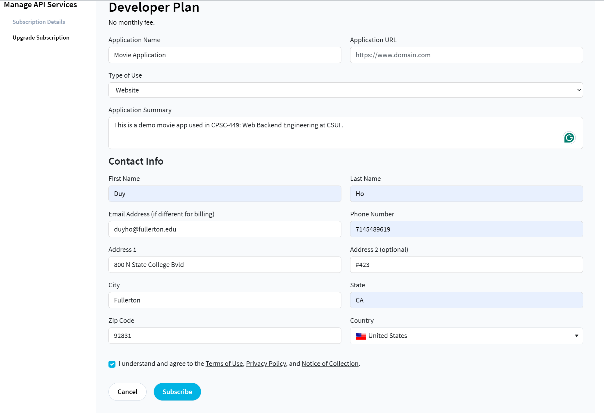
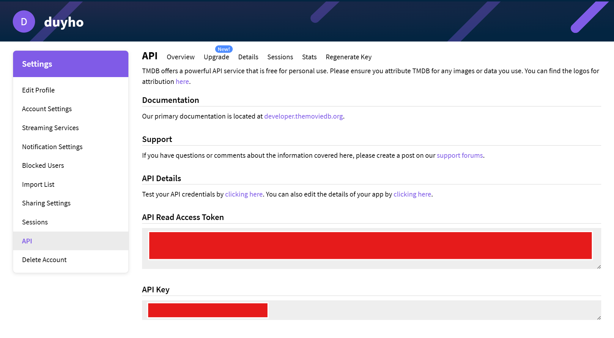

# CPSC 449 Lab 07: Movie Recommender with TMDb API

## Overview

In this lab, you will research three third-party APIs for your project and examine a full-stack Movie Recommender that uses [The Movie Database (TMDb)](https://www.themoviedb.org/) as its data source. The application is built with Node.js, Express, HTML, CSS, and browser JavaScript.

Express serves the frontend files from `public/`, sends requests to TMDb, and returns normalized movie data to the browser as JSON. The application supports searching by title, filtering by genre, requesting a random popular movie, and viewing movie details, cast members, and reviews.

Your main task is to investigate three APIs: one public API that does not require a key, one private API that requires authentication, and one additional API of either type. For each API, you will use Postman to test at least two `GET` endpoints, inspect the response data, and explain how the API could support your final project.

## Learning Objectives

By the end of this lab, you should be able to:

- Explain the role of a third-party API in a full-stack application.
- Protect an API key with an environment variable.
- Test API endpoints and inspect JSON responses with Postman.
- Identify routes, parameters, fields, and return values in API documentation.
- Send HTTP requests from an Express server with Axios.
- Transform third-party API responses for use by a frontend.
- Use browser JavaScript to request and display API data.
- Compare public and private APIs and evaluate whether they are useful for a larger application.

## Before You Start

1. Install Node.js and npm if they are not already installed.
2. Install Postman and complete any assigned Postman setup.
3. Create a free TMDb account if you want to run the supplied movie application.
4. Obtain a TMDb Developer API Key (v3) from your TMDb account settings.

Verify Node.js and npm from a terminal:

```bash
node -v
npm -v
```

Never commit API keys or other secrets to GitHub. Automated tools routinely scan public repositories for exposed credentials.

## Project Structure

```text
.
|-- images/
|   |-- apikey_hidden.png
|   `-- developer_plan.png
|-- models/
|   `-- Movie.js
|-- public/
|   |-- details.html
|   |-- details.js
|   |-- index.html
|   |-- profile_img.png
|   |-- script.js
|   `-- styles.css
|-- package.json
|-- package-lock.json
`-- server.js
```

- `server.js` configures Express and requests movie data from TMDb with Axios.
- `public/index.html` contains the movie search and recommendation interface.
- `public/script.js` calls the Express routes and displays movie results.
- `public/details.html` contains the individual movie details view.
- `public/details.js` loads movie details, cast members, and reviews.
- `public/styles.css` controls the main page appearance.
- `models/Movie.js` contains the earlier MongoDB movie model retained by the starter.

The browser calls this application's Express routes. The server then calls TMDb with the private API key and returns only the data needed by the frontend.

## Setup and Running the App

1. Open a terminal in the project directory.
2. Install the dependencies:

   ```bash
   npm install
   ```

3. Create a `.env` file in the project root:

   ```text
   TMDB_API_KEY=your_tmdb_api_key_here
   ```

4. Start the development server:

   ```bash
   npm run dev
   ```

5. Open the application:

   ```text
   http://localhost:3000/
   ```

Always load the frontend through Express. Do not open `public/index.html` directly from the filesystem. Keep the server terminal open while testing, and check it for TMDb or configuration errors.

## Obtaining a TMDb API Key

1. Visit [TMDb](https://www.themoviedb.org/) and create an account or sign in.
2. Open your account settings.
3. Select the **API** section.
4. Request a Developer API Key (v3).
5. Accept the terms and briefly describe the classroom application.
6. Add the issued key to `.env`; do not paste it into `server.js` or frontend code.





## Application API

The supplied Express server wraps several TMDb endpoints and returns JSON to the frontend.

| Method | Endpoint | Expected behavior |
| --- | --- | --- |
| `GET` | `/movies/random` | Return one randomly selected popular movie. |
| `GET` | `/movies/search?name=:name&genre=:genre` | Search by title and optionally filter the results by genre. |
| `GET` | `/movies/genres` | Return a mapping of TMDb genre IDs to genre names. |
| `GET` | `/movies/details/:id` | Return details, cast members, and reviews for one movie. |

Example requests:

```text
http://localhost:3000/movies/random
http://localhost:3000/movies/search?name=Avengers
http://localhost:3000/movies/search?name=Avengers&genre=action
http://localhost:3000/movies/genres
http://localhost:3000/movies/details/299536
```

A movie returned by the search route uses a simplified structure similar to this:

```json
{
  "id": 299536,
  "title": "Avengers: Infinity War",
  "overview": "...",
  "release_date": "2018-04-25",
  "vote_average": 8.2,
  "poster_url": "https://image.tmdb.org/t/p/w500/...",
  "genres": "Adventure, Action, Science Fiction"
}
```

## Student TODOs

### TODO 1: Inspect the Supplied Application

Run the application and trace how data moves through it.

- Request a random movie and search for a movie by name.
- Select different genres and inspect how the displayed results change.
- Open a movie's details page and confirm that its details, cast, and reviews load.
- Use the browser's Network panel to inspect the requests sent to Express.
- Locate the corresponding Express routes in `server.js`.
- Identify the TMDb endpoints called by each Express route.

Pay attention to the difference between a browser request to this application's server and the server's request to TMDb.

### TODO 2: Inspect TMDb with Postman

Use your own TMDb API key in Postman to request TMDb data directly and study the response structure.

At minimum:

1. Send a successful `GET` request to a TMDb endpoint.
2. Confirm the response status is successful.
3. Identify the top-level response fields.
4. Inspect several movie fields, such as `id`, `title`, `genre_ids`, `poster_path`, and `vote_average`.
5. Compare the TMDb response with the smaller object returned by this application's Express server.

Do not expose your full API key in a submitted screenshot. Use a Postman variable, hide the relevant portion, or crop it from the image.

### TODO 3: Test the Finished TMDb Demo Application

Add your own TMDb API key to `.env`, start the Express server, and test the complete demo application at `http://localhost:3000/`. Confirm all of the following:

- The HTML, CSS, and JavaScript load without 404 errors.
- **Get Random Movie** displays a movie returned by TMDb.
- A title search returns relevant results.
- Genre filtering changes the returned results.
- **View Details** opens the correct movie.
- Movie details, cast members, and reviews load successfully.
- **Clear** restores the initial interface.
- The browser console contains no unexpected errors during normal use.
- The TMDb API key is not visible in frontend requests or committed files.

Complete this demo testing before beginning your independent API research. It provides a working example of how an authenticated third-party API can be accessed by an Express backend without exposing the API key to the browser.

### TODO 4: Research Three APIs for Your Project

Research several APIs before choosing three that provide useful data for your project. Good places to begin include:

- [Postman API Network](https://www.postman.com/explore)
- [Public APIs on GitHub](https://github.com/public-apis/public-apis)
- [Free APIs](https://free-apis.github.io/)
- [RapidAPI](https://rapidapi.com/)
- Official API documentation found through a web search

Do not select the first three APIs you find. Compare several candidates based on their available data, documentation quality, authentication requirements, request limits, and usefulness to your project.

Your final selections must satisfy these categories:

| API | Required type | Authentication requirement |
| --- | --- | --- |
| API 1 | Public/keyless | Must work without an API key, token, or account. |
| API 2 | Private/authenticated | Must require an API key, bearer token, OAuth, or another credential. |
| API 3 | Your choice | May be either public/keyless or private/authenticated. |

Each selected API:

- Should provide data that could be useful in your final project.
- Must expose at least two testable `GET` endpoints.
- Must return structured data with multiple fields and values.
- Must have documentation that explains its routes and parameters.

For this lab, **private API** means an API that requires authentication. It does not mean that you need access to a company's internal or restricted service.

### TODO 5: Test Two Routes per API with Postman

Test at least two distinct `GET` routes from each of your three APIs, for a minimum of six successful requests. For each request:

1. Record the endpoint and any path or query parameters.
2. Send the request in Postman.
3. Confirm the response status.
4. Inspect the JSON response body.
5. Identify fields that would be useful to your application.
6. Save clear evidence of the working request.

The two tests for each API must exercise distinct routes. Changing only a search keyword on the same route does not count as testing a second endpoint.

### TODO 6: Explain Your API Choices

For each of the three APIs, write a short, two- to three-sentence explanation that includes:

- Why you selected the API.
- What useful data it provides.
- How that data could support your project.

Include a link to each API's official documentation or another authoritative resource. Clearly label each API as public/keyless or private/authenticated.

## Completion Checklist

- [ ] Node.js dependencies are installed and the supplied application runs.
- [ ] `TMDB_API_KEY` is stored in `.env` and is not committed to GitHub.
- [ ] The supplied TMDb application has been inspected and tested.
- [ ] Three APIs relevant to the project have been selected.
- [ ] API 1 is public/keyless and works without authentication.
- [ ] API 2 is private/authenticated and requires credentials.
- [ ] API 3 is either public/keyless or private/authenticated.
- [ ] Each API has documentation and at least two `GET` routes.
- [ ] Two distinct routes per API have been tested successfully in Postman.
- [ ] The response status, fields, and values for all six requests have been inspected.
- [ ] Clear Postman evidence has been captured without exposing secrets.
- [ ] A link to each API's documentation is included.
- [ ] A two- to three-sentence explanation describes each API's value.

## Submission Requirements

Submit the items required by your instructor, including:

1. The names of all three APIs, clearly labeled as public/keyless or private/authenticated.
2. Postman evidence showing two distinct successful `GET` routes for each API.
3. A link to the official documentation for each API.
4. A two- to three-sentence explanation for each API describing why you chose it and how it could be useful for your project.

Before submitting, confirm that all screenshots are readable and do not reveal an API key, bearer token, password, or other secret. Commit and push any required repository changes to the correct repository and branch. Do not commit `.env` or `node_modules/`.

## Troubleshooting

### The server reports that the API key is missing

- Confirm that `.env` is in the project root beside `server.js`.
- Confirm the variable is named exactly `TMDB_API_KEY`.
- Restart the server after creating or changing `.env`.
- Confirm that the key does not contain unintended spaces or quotation marks.

### TMDb returns an authentication error

- Confirm that the key is active and was copied correctly.
- Confirm that you are using the Developer API Key (v3) expected by the starter.
- Check the server terminal for the complete TMDb error response.

### The page loads but no movies appear

- Confirm that `npm run dev` is still running.
- Check the browser Console and Network panels.
- Request `http://localhost:3000/movies/random` directly and inspect the JSON response.
- Check the server terminal for an Axios or TMDb error.

### The details page does not load

- Confirm that the page URL contains a valid movie ID.
- Request `/movies/details/:id` directly with that ID.
- Check whether TMDb returned details, credits, and reviews successfully.

### A Postman request fails

- Recheck the API documentation for the HTTP method, URL, required headers, and parameters.
- Confirm that authentication values are configured without exposing them in screenshots.
- Inspect the response body; many APIs return a useful error message even when the status is not successful.
- Check whether the API enforces rate limits or account restrictions.
